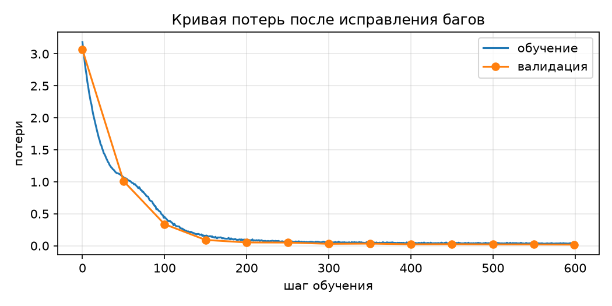

# ДЗ1. Attention + охота на баги

**Вариант: seed 42.** Во втором ноутбуке было ровно **3** семантические ошибки; все
исправлены. Итог: **17/17** проверок, обучение 600 шагов, train loss **3.186 → 0.035**,
validation loss **3.064 → 0.018**, генерация воспроизводит структуру корпуса.

## Быстрый старт

### 1. Окружение

Нужен Python 3.10+ и PyTorch. Проверено на Python 3.15.2, torch 2.15.0+cpu,
matplotlib 3.11.2, Windows 11; 

```powershell
python -m venv .venv
.\.venv\Scripts\Activate.ps1
python -m pip install --upgrade pip
python -m pip install torch --index-url https://download.pytorch.org/whl/cpu
python -m pip install -r requirements.txt
```

### 2. Проверки

```bash
python scripts/run_checks.py
```

Ожидаемый вывод — 17 строк `ok` и итог:

```text
пройдено 17 из 17
Все проверки зелёные.
```

Код возврата `0`. Скрипт запускает ровно те проверки, которые лежат в ноутбуках
(`src/checks.py`), и не обращается к скрытым тестам.

### 3. Обучение и генерация

```bash
python scripts/train_toy.py
```

Скрипт обучает ту же модель на том же игрушечном корпусе 600 шагов, считает
validation loss на отложенных 10% корпуса и генерирует 200 символов. Ориентир:

```text
шаг    0  потери 3.1860  val 3.0644
шаг  100  потери 0.4511  val 0.3370
шаг  200  потери 0.0883  val 0.0516
шаг  300  потери 0.0534  val 0.0299
шаг  400  потери 0.0432  val 0.0226
шаг  500  потери 0.0426  val 0.0210
итог: 3.186 -> 0.035; val 3.064 -> 0.018
```

Файлы `results/loss_curve.png`, `results/generated_text.txt` и
`results/training_metrics.json` перезаписываются. Точные значения могут немного
отличаться из-за версии PyTorch/BLAS, но падение потерь и структура текста
воспроизводятся устойчиво.



### 4. Ноутбуки

Ноутбуки уже содержат outputs, поэтому их можно смотреть без запуска. Если нужно
перезапустить:

```bash
python -m pip install jupyterlab
jupyter lab notebooks/
```

`notebooks/dz1-attention.ipynb` — реализованные `split_heads`, `merge_heads`,
`scaled_dot_product_attention`, `TransformerBlock.forward`; в конце 17/17.
`notebooks/dz1-bughunt.ipynb` — исправленный второй ноутбук: 17/17, кривая потерь,
пример генерации.

## Найденные ошибки

| № | Локализация | Механизм нарушения | Исправление |
|---|---|---|---|
| 1 | `LayerNorm.forward`, строки 60–61 | `mean`/`var` считаются по батчу (`dim=0`), а не по признакам токена (`dim=-1`). При `B=1` слой возвращает только `bias`, вход перестаёт влиять на выход; при нулевом `bias` логиты вырождаются, softmax становится равномерным, top-k выбирает случайно. На обучении результат зависит от состава батча. | `dim=0 → dim=-1` в `mean` и `var`. |
| 2 | `scaled_dot_product_attention`, строка 101 | Softmax по запросам (`dim=-2`) вместо ключей (`dim=-1`). Строки матрицы внимания перестают быть распределениями, а вес ключа зависит от будущих запросов: причинная маска не разрывает эту зависимость, информация течёт из будущего. | `dim=-2 → dim=-1`. |
| 3 | `sinusoidal_positional_encoding`, строка 39 | Позиции начинаются с 1 (`arange(1, length + 1)`) вместо 0. Первый токен получает код второй позиции, нулевой якорь (`sin 0 = 0`, `cos 0 = 1`) теряется, абсолютная позиционная разметка сдвинута на единицу. | `arange(1, length + 1) → arange(0, length)`. |

Проверка `no_future_leak_in_model` на исходном коде формально проходила только
потому, что ошибка LayerNorm при `B=1` обнуляла логиты и маскировала утечку. После
исправления LayerNorm она бы падала; поэтому обе ошибки исправляются вместе.

## Ожидаемые результаты

| Команда/файл | Ожидание |
|---|---|
| `python scripts/run_checks.py` | `пройдено 17 из 17`, exit code 0 |
| `python scripts/train_toy.py` | train loss < 0.1, val loss < 0.1, текст повторяет фразу корпуса |
| `notebooks/dz1-attention.ipynb` | все 17 проверок зелёные |
| `notebooks/dz1-bughunt.ipynb` | все 17 проверок зелёные, график и пример генерации |
| `results/loss_curve.png` | две кривые: обучение и валидация, обе убывают к нулю |

Пример генерации (начальный токен `а`, `temperature=0.8`, `top_k=10`):

```text
азу. алгоритм внимания смотрит на все позиции сразу. алгоритм внимания смотрит на все позиции сразу.
алгоритм внимания смотрит на все позиции сразу. алгоритм внимания смотрит на все позиции сразу. алго
```

Модель продолжает с середины слова и далее точно воспроизводит повторяющийся шаблон —
для игрушечного корпуса это ожидаемый результат: проверяется структура, а не
обобщение на новый текст.

## Воспроизводимость и детали

- Корпус: `"алгоритм внимания смотрит на все позиции сразу. " * 200`; 9600 символов,
  алфавит 19 символов. Внешние данные не нужны.
- Модель: `d_model=128`, 4 головы, 2 слоя, `dropout=0.1`, контекст 64, батч 32.
- Оптимизатор: AdamW, `lr=3e-4`, 600 шагов; хвостовые 10% корпуса — валидация.
- Seed обучения: 0 (`torch.manual_seed(0)`), seed проверок задан внутри проверок.
- Валидационные окна фиксированы, поэтому кривая val сопоставима между шагами.
- Время обучения на CPU: около 30 секунд (зависит от машины).
- `src/minigpt.py` и `src/checks.py` сгенерированы из исполненных ноутбуков и
  совпадают с кодом, который проходит проверки. `src/attention.py` — тонкий
  реэкспорт четырёх функций шага 1.

## Отчёт

- `report/errors_table.md` — таблица «локализация / механизм / исправление».
- `report/otchet-dz1-bughunt.docx` — отчёт на 2 страницы: таблица, кривая потерь,
  пример генерации.
- `report/otchet-dz1-bughunt.pdf` — та же версия в PDF.
- `results/checks_attention.txt`, `results/checks_bughunt_before.txt`,
  `results/checks_bughunt_after.txt` — логи прогонов: 17/17, 7/17 до исправлений,
  17/17 после.
